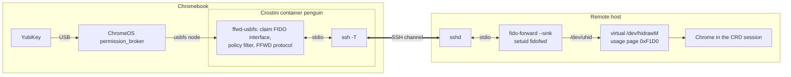

# YubiKey forwarding from a Chromebook to a remote host: design study

Status: study, 2026-11-10.
Tests T0 to T2 ran on a Chromebook on 2026-11-09 with a U2F-only Google Titan key; they passed, with a U2F-only Google Titan key and with a YubiKey 5 (TESTPLAN.md, results table).
The test plan is in [TESTPLAN.md](TESTPLAN.md).
The raw research notes, with all sources, are in [research/](research/).

## 1. Summary

Use a CTAPHID relay (approach B) for WebAuthn.
Use agent forwarding (approach D) for OpenPGP and PIV.

An existing project, txomon/fido-forward, does most of approach B.
It cannot run in Crostini as it is.
Crostini gives the container the key only as a usbfs node, `/dev/bus/usb/BBB/DDD`.
fido-forward reads the key through `/dev/hidraw`, and Crostini has no `/dev/hidraw` node.

The smallest new component is a key-side relay that reads the key through usbfs.
It speaks fido-forward's wire protocol, so the remote host uses fido-forward unchanged.
This workspace already has the two packages that this component needs, with tests:
`ctaphid` (framing and a command policy) and `usbfs` (pure Go, no cgo).
The probe `cmd/fido-probe` tests the one fact that decides the design.

The fallback is a userspace USB/IP server (approach A).
It forwards all YubiKey functions, but it gives the remote root user raw control of the key.

## 2. Facts that decide the design

| # | Fact | Status | Source |
|---|---|---|---|
| F1 | The Crostini container gets a shared USB device only as its usbfs node. It gets no `/dev/hidraw` node. On the tested Chromebook the node is `0664 root:root`, so a process needs root (`sudo` in penguin) to write to it; the source said 0666. | Verified (source and test T1) | tremplin `start_lxd.go` L192-228, L366 (research/A-B); TESTPLAN.md T1 |
| F2 | ChromeOS can refuse to share a YubiKey. permission_broker can return DENY or LOCKDOWN. The Smart Card Connector app can block sharing. | Verified | permission_broker `allow_conforming_usb_device_rule.cc`; chromium-os-dev threads (research/A-B) |
| F3 | A key shared with Crostini is not available to ChromeOS while it is shared. | Verified (one report) | crosvm-dev thread (research/D) |
| F4 | `vmc key-attach` shares the key with ChromeOS at the same time, but it supports U2F only. FIDO2 hangs. | Verified | crosvm-dev thread; crosvm book |
| F5 | The kernel lets any process that opens a usbfs node detach the kernel driver from an interface. There is no capability check. | Verified | `drivers/usb/core/devio.c` |
| F6 | Chrome on Linux uses any HID device with usage page 0xF1D0, on any bus. | Verified | `fido_hid_discovery.cc` L46-47, L77-86 |
| F7 | Chrome waits 20 s for a FIDO device. Each CTAPHID keepalive restarts the timer. | Verified | `fido_constants.cc` L191; `fido_hid_device.cc` L387-392 |
| F8 | Public Chrome Remote Desktop does not forward security keys. The policies for it are internal only, or for managed users only. | Verified | policy YAML files (research/C-E) |
| F9 | A real key cannot sign for a virtual authenticator. A relay must forward whole CTAP commands. | Verified | virtual-fido `ctap/ctap.go` L250, L364 (research/C-E) |
| F10 | A forwarded ssh-agent does not sign WebAuthn challenges with non-`ssh:` FIDO keys. | Verified | OpenSSH 8.4 release notes |

F1 and F5 together gave the main open question.
Test T2 answered it on 2026-11-09: as root, a process in the container detached usbhid from a FIDO key's interface, claimed it, and got a CTAPHID_INIT reply in 3 ms (TESTPLAN.md).
The first key was a U2F-only Google Titan key. A second run with a YubiKey 5 (firmware 5.8.0) passed too: CTAPHID_INIT in 4 ms, and authenticatorGetInfo in 230 ms reported FIDO_2_0 and FIDO_2_1.

## 3. Comparison of approaches

Legend: Yes, No, Partly.
"Crostini OK" means: it works in Crostini with no root on ChromeOS, no kernel module and no developer mode.
"Both" means: the key works on the Chromebook and on the remote host at the same time.

| Approach | Existing software | FIDO2 / U2F | OTP | PIV | OpenPGP | Crostini OK | Both | Main security risk | Latency and timeout risk |
|---|---|---|---|---|---|---|---|---|---|
| A. Userspace USB/IP server in Crostini, `vhci-hcd` on the remote | jiegec/usbip (Rust, MIT, 2026-11, serial transfers, YubiKey issue #51 unsolved); yunsmall/usbipdcpp (C++, LGPL-3.0, 2025-07, async libusb) | Yes (assumption) | Yes (assumption) | Yes (assumption) | Yes (assumption) | Partly: needs F2 to allow sharing; no module needed on the Chromebook | No | Remote root gets raw USB to all applets: it can reset FIDO, PIV and OpenPGP and change the OTP slots. USB/IP has no authentication. | jiegec/usbip blocks for 1 s per transfer: high risk. usbipdcpp is async: low risk (assumption). |
| B. CTAPHID relay, uhid on the remote | txomon/fido-forward (Go, MIT, 2026-10, one author): remote side usable as is, key side needs `/dev/hidraw`. New usbfs key-side relay needed (section 6). | Yes | No | No | No | Partly: needs F2, and the probe must pass (F1, F5) | No | Remote root can send any CTAP command. The new relay blocks reset and credential management. Remote can still ask for assertions for any RP ID (phishing through the relay). Touch is still required. | Low. Keepalives pass through (F7). Each report adds one SSH round trip. |
| B'. qubes-app-u2f with SSH in place of qrexec | QubesOS/qubes-app-u2f (Python, GPL-2.0+, 2026-10) | Partly: 4 CTAP2 commands only; open bugs with Chromium and libfido2 | No | No | No | No: its key side needs hidraw through python-fido2 | No | Built-in command filter. Same phishing risk as B. | High: it sends no keepalives, so a touch after 20 s fails (F7). |
| C. Virtual FIDO device on the remote, crypto on the real key | bulwarkid/virtual-fido (Go, MIT, 2024-06, beta); psanford/tpm-fido (U2F only) | No: signing cannot be delegated (F9). It becomes B. | No | No | No | Not applicable | Not applicable | Not applicable | Not applicable |
| D. ssh-agent and gpg-agent forwarding | OpenSSH, GnuPG, p11-kit (BSD-3, 2026-08) | No (F10) | No | Yes, through PKCS#11 in the local agent, or p11-kit server | Yes, gpg-agent extra socket | Partly: pcscd and scdaemon in Crostini are reported to work. ssh `-sk` keys do not work in Crostini (no hidraw, F1). | No (needs the key shared, F3) | Remote root can use the agent while the session is open. gpg restricts the extra socket. Use `ssh-add -c` and PIV touch policy. | Low: one round trip per signature |
| E1. Hybrid (phone as authenticator) | Chrome built in | Yes, with a phone, not the YubiKey | No | No | No | Not applicable | Yes | Low | Needs Bluetooth near the remote host (CTAP 2.2 hybrid). Not possible for a remote host. |
| E2. CRD security key forwarding | Chrome Remote Desktop | Only with the Google internal client | No | No | No | Not applicable | Not applicable | Not applicable | Not available (F8) |
| E3. WebAuthn proxy extension on the remote (`chrome.webAuthenticationProxy`) | parallelworks/auth-relay (Python and JS, no license, 2026-05); pedropaulovc/passkey (Go, MIT, WSL only) | Yes (assumption) | No | No | No | No: its local side uses python-fido2 on hidraw (F1) | No | The proxy event has no origin field. auth-relay guesses the origin from the active tab. A wrong guess breaks origin binding. | Low |
| E4. PC/SC relay (vsmartcard `vicc --type=relay` to `vpcd`) | frankmorgner/vsmartcard (GPL-3.0, 2026-10) | No | No | Yes (assumption) | Yes (assumption) | Partly: needs pcscd in Crostini | No | Remote root can send any APDU: PIN guesses, applet reset. | Low (assumption) |
| E5. Use the Chromebook's own Chrome with an SSH SOCKS proxy | Chrome, OpenSSH | Yes, for web apps the remote host serves | No | No | No | Yes: no key sharing needed | Yes | Low: the key stays with ChromeOS | Low. Does not help when the login must happen inside the remote desktop. |
| E6. `vmc key-attach` (crosvm virtual U2F) | ChromeOS built in | U2F only (F4) | No | No | No | Partly: needs `crosh` and a manual LXD device | Yes | As B | U2F only, so no passkeys |

## 4. Recommendation

### 4.1 WebAuthn: approach B with a new usbfs key-side relay

Reasons:

1. It forwards only the FIDO interface.
   PIV, OpenPGP and OTP stay on the Chromebook.
   This is a smaller attack surface than USB/IP.
2. The relay can refuse commands that erase or change the key (reset, credential management, config, bio enrollment, large blobs).
   The `ctaphid.Policy` type in this workspace does this, and has tests.
3. The remote half exists: fido-forward's sink, setuid to a dedicated user, drops privilege before it reads input.
   It builds with Bazel here, for amd64 and arm64.
4. SSH is the only transport and the only authentication.
   No TCP port opens on either host.
5. Keepalives pass through unchanged, so a slow touch does not time out (F7).

Known limits:

* The key cannot work on ChromeOS while it is shared with Crostini (F3).
* The relay cannot stop a compromised remote host from asking for an assertion for another site.
  The key shows no site name.
  Only the touch protects the user.
  Mitigation: run the relay only while you need it, and touch the key only when you started a login.
* fido-forward is one month old and has one author.
  Its sink side is about 610 lines of Go (`internal/cli/sink.go`, `relay/sink.go`, `uhid`, `privs`, `sinkready`, `wire`); read it before you trust it (section 7).

### 4.2 OpenPGP and PIV: approach D

* OpenPGP: forward the gpg-agent extra socket with `RemoteForward`.
  Run scdaemon and pcscd in Crostini.
* PIV: run `p11-kit server` with ykcs11 or OpenSC in Crostini, and forward its socket with `ssh -R`.
  Or load the PIV key into the local ssh-agent with `ssh-add -s` and use agent forwarding.
* ssh `-sk` keys: they cannot be used from Crostini (F1).
  On the remote host they work through the virtual key of approach B, because the remote host has a hidraw node.

The FIDO relay claims only the FIDO interface, and pcscd claims only the CCID interface.
The two should work at the same time (assumption, open question Q6).

### 4.3 Fallback: approach A with yunsmall/usbipdcpp

Use it if the probe fails, or if you need PIV and OpenPGP as real devices on the remote host.
It forwards every YubiKey function.
It gives the remote root user full control of the key, so use it only with a remote host that you trust fully.
Do not use jiegec/usbip for this: it handles one transfer at a time with a 1 s timeout, and a YubiKey failure report (issue #51) has no fix.

## 5. Data flow of the recommended design



The same flow as text:

```
Chromebook                                         Remote host
YubiKey
  | USB
permission_broker (share with Linux)
  | /dev/bus/usb/BBB/DDD
ffwd-usbfs  <== ssh -T, FFWD v1, 64-byte reports ==>  fido-forward --sink
  (claims interface 1,                                  (setuid fidofwd)
   filters CTAP commands)                                 | /dev/uhid
                                                        /dev/hidrawM (FIDO)
                                                          |
                                                        Chrome (WebAuthn)
```

One WebAuthn login:

1. Chrome on the remote host writes a CTAPHID request to `/dev/hidrawM`.
2. The sink reads it from `/dev/uhid` and sends 64-byte reports up the SSH channel.
3. `ffwd-usbfs` joins the reports, checks the CTAP command against the policy, and writes them to the key's interrupt OUT endpoint.
4. The key sends keepalives until you touch it, then the response.
5. `ffwd-usbfs` reads them from the interrupt IN endpoint and sends them down the SSH channel.
6. The sink writes them to `/dev/uhid`, and Chrome reads them.

## 6. The smallest new component: `ffwd-usbfs`

Written after probe test T2 passed (TESTPLAN.md): `cmd/ffwd-usbfs`, with the relay in `relay/` and the key access in `usbfs/fido.go`.
It passed the end-to-end test T4 on 2026-11-09: a WebAuthn registration and sign-in in Chrome on a remote host, with the YubiKey on a Chromebook.

| Item | Design |
|---|---|
| Purpose | The key side of fido-forward, for a host where the key has a usbfs node and no hidraw node |
| Language | Go 1.27, `CGO_ENABLED=0`, built with Bazel (`rules_go`) |
| Libraries | `golang.org/x/sys/unix` only, plus `//usbfs` and `//ctaphid` from this workspace |
| Command line | `ffwd-usbfs [-d /dev/bus/usb/BBB/DDD] [--allow-management] HOST` |
| Transport | Starts `ssh -T -o ServerAliveInterval=5 -o ServerAliveCountMax=3 -- HOST fido-forward --sink` over pipes, as fido-forward's client does. Under `sudo`, it opens the key, then switches to the `SUDO_UID` user before `ssh` starts, so `ssh` uses that user's keys. |
| Wire protocol | fido-forward v1: read `FFWD\x01` from the sink, write it back, then raw 64-byte reports both ways |
| USB side | Find the HID interface with usage page 0xF1D0; detach usbhid; claim it; one goroutine reads interrupt IN, one writes interrupt OUT |
| Policy | Judge each request by its init packet (the command and the first payload byte are there). Answer a refused CTAP2 command with status `0x27` (CTAP2_ERR_OPERATION_DENIED), and a refused CTAPHID vendor command (0xC0 and up; a YubiKey changes its configuration with these) with CTAPHID_ERROR 0x01. Drop the continuation packets. Refused requests never reach the key. |
| Teardown | Send CTAPHID_CANCEL on each forwarded channel, release the interface, attach usbhid again |
| Size | 586 lines, and 214 lines of tests in `relay/relay_test.go` |
| Exit codes | Same as fido-forward: 0 clean, 1 transport failure, 2 usage, 3 key or permission error |

Interfaces that exist now in this workspace:

* `ctaphid.Split(Message) ([][]byte, error)` and `(*ctaphid.Assembler).Add([]byte) (*Message, error)`: framing.
* `ctaphid.Policy{AllowManagement bool}.Allowed(Message) bool`: the command filter.
* `usbfs.Open`, `Descriptors`, `Detach`, `Claim`, `ReportDescriptor`, `Interrupt`, `Release`, `Reattach`: the key access.

Design choice to make later: the first version uses one synchronous interrupt read with a 200 ms timeout in a loop.
A later version can use asynchronous URBs (`USBDEVFS_SUBMITURB`, `USBDEVFS_REAPURB`) to keep an IN transfer pending at all times.

## 7. Security notes

| Risk | Where | Mitigation |
|---|---|---|
| Remote host erases the key (authenticatorReset) or lists and deletes passkeys | B | `ctaphid.Policy` refuses 0x07, 0x09, 0x0A, 0x0C, 0x0D, 0x40, 0x41 and unknown commands. Reset also needs a touch within 10 s of power-up (CTAP 2.1). |
| Remote host gets an assertion for a site that you did not open (phishing through the relay) | B, E3 | Cannot be blocked: the RP ID comes from the remote Chrome. Run the relay only when you need it. Touch only for a login that you started. Prefer passkeys with PIN (user verification). |
| Remote host guesses the FIDO PIN | B | The key blocks after 8 wrong PINs, and asks for a power cycle after 3 (CTAP 2.1 clientPIN). |
| Remote root takes full raw control of the key | A, E4 | Use approach B for FIDO. Use A only with a fully trusted host. |
| Other local users on the remote host use the virtual key | B | fido-forward's udev rule gives the virtual hidraw node to the group `fido-forward-users` only. |
| A Crostini process other than the relay opens the usbfs node (mode 0666) | A, B | Crostini is single user. Accept, or stop sharing the key when you do not use it. |
| A forwarded agent signs for any process on the remote host | D | `ssh-add -c` (confirm each use), PIV touch policy, `ssh-add -h` destination constraints. gpg restricts the extra socket. |
| The `/dev/uhid` sink runs setuid | B | fido-forward drops privilege before it reads input, and uses no cgo, so the drop covers all threads (fido-forward REQUIREMENTS "Sink privilege model"). Review the sink before you install it. |

## 8. Open questions to test on the real Chromebook

| # | Question | Test |
|---|---|---|
| Q1 | Does ChromeOS let you share the YubiKey with Linux on this Chromebook? Does it return ALLOW_WITH_DETACH, LOCKDOWN or DENY? | T1 |
| Q2 | Does the container see the key under `/dev/bus/usb`, with mode 0666? | T1 |
| Q3 | Can a process in the container detach usbhid from the FIDO interface, claim it, and run CTAPHID_INIT and authenticatorGetInfo? | T2: **yes, as root** (2026-11-09; Titan key and YubiKey 5, FIDO 2.1) |
| Q4 | Is the Chromebook amd64 or arm64? | T0 (`uname -m`) |
| Q5 | Does the round trip over SSH stay well below Chrome's 20 s device timeout during a touch? | T4: **yes**, a touch-gated registration and sign-in worked; T5 measures it |
| Q6 | Can pcscd claim the CCID interface while the relay holds the FIDO interface? | T6 |
| Q7 | Does Chrome in the CRD session get read and write access to the virtual hidraw node? | T4: **yes**, through the `fido-forward-users` group, once the CRD session has the group (2026-11-09) |
| Q8 | Does the key come back to ChromeOS when you stop sharing it, with no replug? | T7: **yes** after the probe (2026-11-09); repeat after T4 |
| Q9 | Does the Smart Card Connector app need to be off? | T1 |

## 9. Workspace

| Path | Content |
|---|---|
| `ctaphid/` | CTAPHID framing and the CTAP2 command policy, with tests |
| `usbfs/` | Pure Go usbfs access: descriptors, detach, claim, interrupt transfers, with tests |
| `cmd/fido-probe/` | The probe for Q3 |
| `research/` | Raw research notes with sources |
| `go.mod`, `MODULE.bazel` | fido-forward at commit 2b7b2ac as a Bazel dependency, built for the compile check |

Build and test: `bazel test //...`.
Build the probe for the Chromebook: see TESTPLAN.md, T0.

## 10. Portability across ChromeOS, macOS and Linux

The relay has two sides, and each side has a different answer.
The key side is where the YubiKey is plugged in.
The use side is where the virtual key appears for a browser.
The raw notes are in [research/F-portability.md](research/F-portability.md).

### 10.1 What each platform can do

| Platform | Key side (read the real key) | Use side (make a virtual key) |
|---|---|---|
| Linux | Yes. `/dev/hidraw` through fido-forward's source, as it is. Over SSH it needs a group rule, unless the same user is logged in at the seat (systemd uaccess). Verified. | Yes. `/dev/uhid` through fido-forward's sink, setuid. Verified. |
| ChromeOS (Crostini) | Yes, if the probe passes. usbfs only, through the new `ffwd-usbfs` (DESIGN.md section 6). The key is not available to ChromeOS while shared. | No. The termina kernel has no UHID or HIDRAW option (verified), and ChromeOS Chrome sees only host devices (assumption). |
| macOS | Yes. IOKit through rafaelmartins/usbhid, pure Go with purego, no cgo. It opens the key without seizing it, so the Mac's own Chrome can use the key at the same time (assumption). No Input Monitoring prompt for the FIDO interface (verified). No root, if the same user is logged in at the Mac's screen (verified). | Hard. A virtual HID device needs the entitlement `com.apple.developer.hid.virtual.device`, which Apple must approve, even for root (verified). It needs a signed app bundle with a provisioning profile. Alternative: approach E3 (a Chrome extension with `chrome.webAuthenticationProxy`), which needs no entitlement but cannot verify the origin. |

### 10.2 What it takes

| Work item | Platform | Size | Blocked by |
|---|---|---|---|
| A key-side backend interface: `Open`, `ReadReport`, `WriteReport`, `Close`, with 64-byte reports. One implementation per platform, chosen by Go build tags. | all | about 50 lines | nothing |
| hidraw backend | Linux | about 100 lines, or reuse fido-forward's source | nothing |
| usbfs backend | ChromeOS, also Linux | about 150 lines on top of the `usbfs` package | probe T2 |
| IOKit backend with rafaelmartins/usbhid | macOS | about 100 lines | nothing; builds from Linux with Bazel (verified) |
| Common client: FFWD protocol, `ctaphid.Policy`, starting `ssh` | all | about 250 lines | nothing |
| Bazel targets for `linux_amd64`, `linux_arm64`, `darwin_amd64`, `darwin_arm64`, all with `--@rules_go//go/config:pure` | all | BUILD files and release workflow | nothing |
| Use side on macOS: a signed Swift helper with the HID virtual device entitlement, which speaks the FFWD protocol on stdio | macOS | about 300 lines of Swift, an Apple Developer account, and Apple's approval | Apple; one public request waited 2.5 months |
| Hardware tests on each key-side platform | all | test plan rows | a Mac and a Linux machine with a key |

The cheapest portable product is: key side on all three platforms, use side on Linux only.
That covers the case in this study (a Chromebook or a Mac in front of the user, and a Linux remote host).
A Mac as the remote host is the only case that needs Apple.

### 10.3 Build

All key-side backends are pure Go, so one Linux machine builds all four targets with Bazel, and no Apple SDK is needed.
Windows is out of scope: since Windows 10 1903, raw FIDO HID access needs Administrator (verified).
